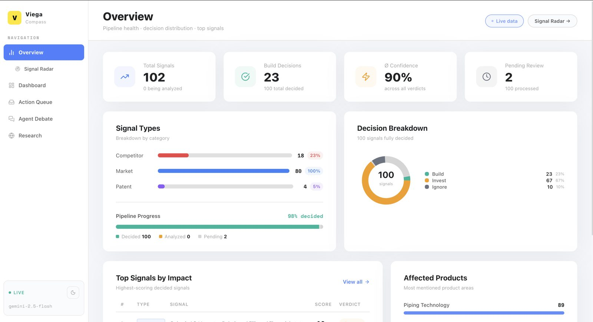
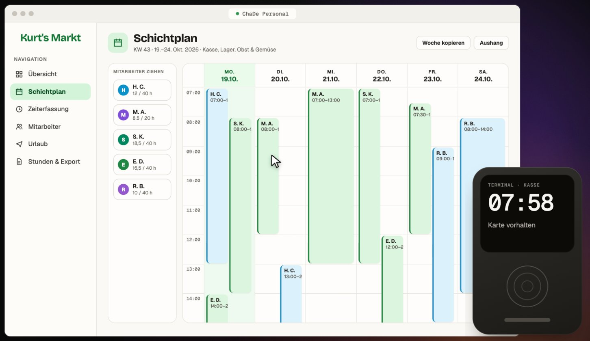
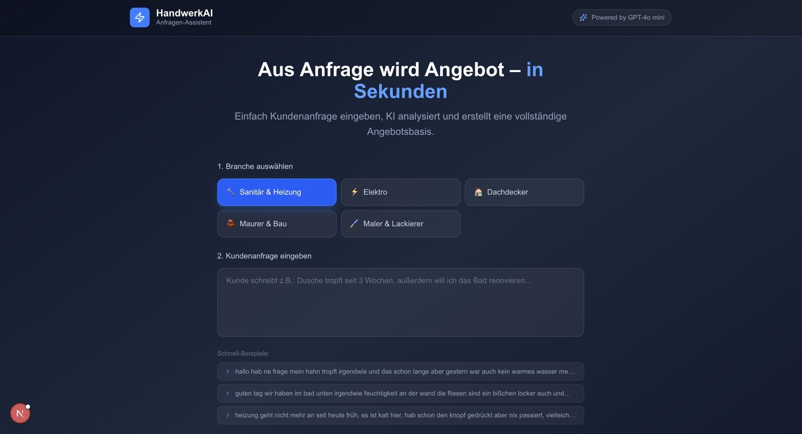

# Hi, ich bin Haytam 👋

Ich studiere Informatik an der **TU Darmstadt** und baue Software, die bei kleinen und mittleren Unternehmen echte Arbeit abnimmt: Web-Apps, KI-Agenten und automatisierte Workflows.

Neben dem Studium entwickle ich mit einem Kollegen in unserer **ChaDe GbR** ein Kassen- und Verwaltungssystem für kleine Märkte. Als Freelancer setze ich Websites und KI-Automatisierungen für lokale Firmen um. Hier zeige ich, was dabei entstanden ist.

📍 Frankfurt am Main · 📫 haytham.charif@gmx.de · 🎓 B.Sc. Informatik, TU Darmstadt

---

## Tech-Stack

| Bereich | Tools |
|---|---|
| Programmierung | Python, TypeScript, JavaScript, SQL, HTML/CSS, REST-APIs, Git |
| Web | React, Next.js, Tailwind CSS, Prisma, PostgreSQL |
| KI & LLMs | LLM-Agenten, Multi-Agenten-Systeme, LangChain, Claude API, Gemini, GPT-4o mini, Prompt Engineering |
| Automatisierung | n8n, Make.com, Claude Code, API-Integration |
| Cloud & Infrastruktur | Vercel, Supabase, Resend, Cloudflare (DNS) |
| Hardware | Arduino |

---

## Projekte

### 🏆 Viega Compass: KI-Plattform für Markttrends
**3. Platz beim Futury Hackathon (Viega Challenge)** · [Live-Demo](https://viega-challenge.vercel.app) · [Code](https://github.com/Haytam-coder/viega-challenge) · [Details](projekte/viega-compass.md)

Ein Multi-Agenten-System, das automatisch Marktsignale sammelt, bewertet und daraus Entscheidungen ableitet. Ein n8n-Workflow sucht alle sechs Stunden neue Signale, entfernt Duplikate und schickt sie an die App. Dort bewertet die KI jedes Signal nach Impact, Relevanz und Dringlichkeit, und drei KI-Personas diskutieren, ob Viega investieren, selbst bauen oder ignorieren sollte. Ich habe das Projekt allein konzipiert und umgesetzt.

`Next.js` `TypeScript` `Prisma` `PostgreSQL` `n8n` `Gemini` `Tavily Search` `Vercel`

---

### ⚡ Kenergy Advisor: KI-Energieberater für Haushalte
**LAUNCH Rhein-Main Build Days 2026** · [Code](https://github.com/Haytam-coder/kenergy-advisor)

Klassische Energieberatung ist teuer und langsam, Tipps im Netz sind zu allgemein. Kenergy Advisor fragt Mieter und Eigentümer in sechs Schritten nach ihrer Wohnsituation, schätzt das Gebäude anhand von Postleitzahl und Baujahr über TABULA-Gebäudetypen ein und liest auf Wunsch die Stromrechnung per Foto aus. Am Ende steht ein persönlicher Sparplan mit Maßnahmen und Förderprogrammen von KfW und BAFA, dazu ein Chat für Rückfragen.

`Next.js` `TypeScript` `Tailwind CSS` `Claude API (Sonnet, Haiku, Vision)` `Bright Sky API`

---

### 🧾 ChaDe Personal: Personalverwaltung für den Einzelhandel
**ChaDe GbR (Mitgründer)** · [Website](https://vorschau.chade.app) · [Details](projekte/chade.md)

Unser eigenes Produkt, das ich mit meinem Mitgründer entwickle. Ein Supermarkt plant und erfasst damit seit Juli 2026 täglich die Arbeitszeiten seines ganzen Teams. Schichten werden per Drag & Drop geplant, und die App warnt, wenn die gesetzliche Ruhezeit nicht eingehalten wird. Mitarbeitende stempeln mit ihrer Karte an einem Terminal, das wir selbst gebaut haben. Urlaub wird mit einem Klick freigegeben, und am Monatsende gehen die Stunden als CSV in die Lohnabrechnung. Eine direkte Anbindung an Lexoffice ist in Planung. Dazu gibt es eine Team-App mit Schicht-Börse.

`Supabase` `Vercel` `Resend` `Kartenleser-Terminal` `Multi-Tenant`

*Der Code ist nicht öffentlich. Die Screenshots zeigen Demo-Daten.*

---

### 🔧 HandwerkAI: Aus Anfrage wird Angebot
**Eigenprojekt für Handwerksbetriebe** · [Details](projekte/handwerkai.md)

Ein Handwerker wählt sein Gewerk, fügt die Nachricht des Kunden ein, und die KI erstellt daraus eine Angebotsbasis. Das funktioniert auch mit unstrukturierten Nachrichten wie "Dusche tropft seit 3 Wochen, außerdem will ich das Bad renovieren". Gedacht für Sanitär, Elektro, Dachdecker, Maurer und Maler.

`LLM` `GPT-4o mini` `Workflow-Automatisierung` `KMU`

---

### 💈 KI-Assistent für einen Barbershop
**Conversational-AI-Demo** · [Details](projekte/barbershop-chatbot.md)

Ein Chatbot für einen Frankfurter Barbershop, der Fragen zu Preisen, Öffnungszeiten und Terminen beantwortet und damit Telefonanrufe spart. Quick-Reply-Buttons decken die häufigsten Anliegen mit einem Klick ab.

`Conversational AI` `React` `KMU`

---

### ⏱️ Arbeitszeiterfassung für einen Supermarkt
**Full-Stack-Eigenprojekt** · [Details](projekte/arbeitszeiterfassung.md)

Eine Web-App, mit der Mitarbeitende eines lokalen Supermarkts ihre Arbeitszeiten stempeln. Ich habe alles allein gebaut: REST-API und Backend in Python, Frontend in React, eine SQL-Datenbank und ein Arduino-Terminal, das die Stempelzeiten direkt an die API schickt.

`Python` `React` `SQL` `REST-API` `Arduino`

---

### ⚙️ Automatisierungen mit Make.com und der Claude API
**Freelance und Eigenbedarf** · [Details](projekte/automationen.md)

- **Bewerbungs-Cockpit:** Automatisierte Bewerbungs-Pipeline mit Make.com, Notion und Gmail.
- **Content-Pipeline:** Automatisierte Tech- und KI-Inhalte für TikTok und Instagram mit Make.com, Claude API und ElevenLabs.
- **Website für ein Logistikunternehmen:** inklusive DNS-Einrichtung und Transaktions-E-Mails über Resend.

`Make.com` `Claude API` `Notion` `ElevenLabs` `Resend`

---

## Kontakt

Ich suche eine **Werkstudentenstelle in Softwareentwicklung oder KI**, gern hybrid oder remote im Raum Frankfurt und Darmstadt.
Schreib mir einfach: **haytham.charif@gmx.de**
