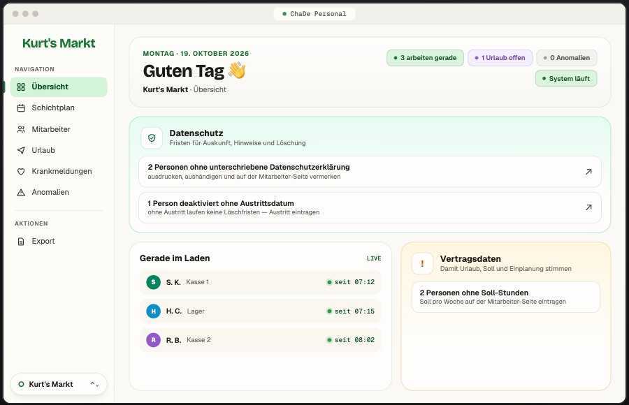
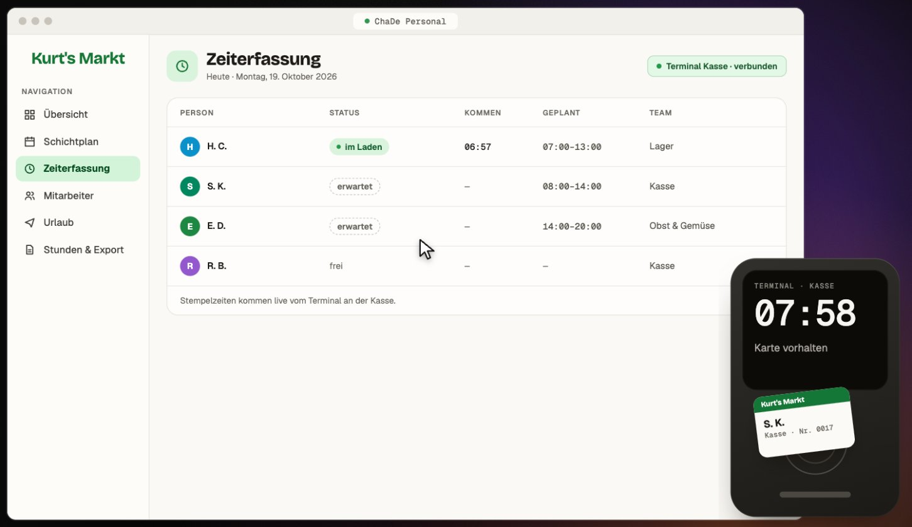
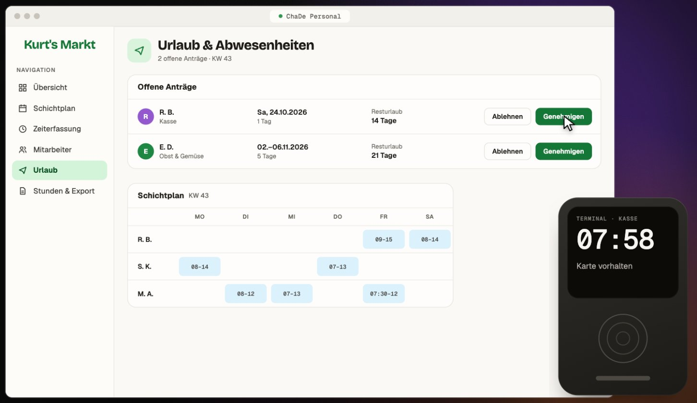
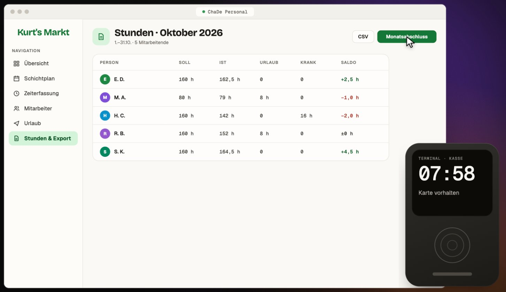
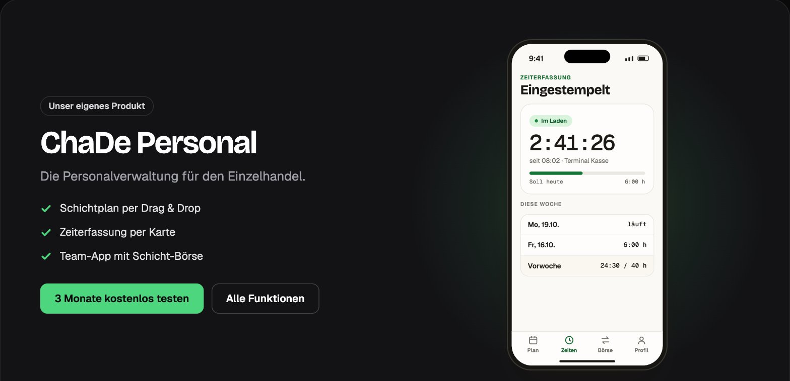

# ChaDe Personal: Personalverwaltung für den Einzelhandel

**ChaDe GbR, Mitgründer seit 06/2026** · [Website](https://vorschau.chade.app) · [Zurück zur Übersicht](../README.md)

## Worum geht es?

In kleinen Läden laufen Schichtplanung und Zeiterfassung oft über Excel-Listen, ausgedruckte Tabellen und Gruppenchats. Mit meinem Mitgründer habe ich die ChaDe GbR gegründet und mit ChaDe Personal unser eigenes Produkt gebaut, das genau das ersetzt.

Seit Juli 2026 plant und erfasst ein Supermarkt die Arbeitszeiten seines ganzen Teams täglich mit unserer Software.

## Funktionen

### Übersicht für die Chefs
Wer gerade im Laden ist, welche Anträge offen sind und welche Daten fehlen, zum Beispiel unterschriebene Datenschutzerklärungen oder Soll-Stunden.

### Schichtplan per Drag & Drop
Mitarbeitende werden in die Woche gezogen. Die App zeigt die geplanten Stunden pro Person und warnt, wenn die Ruhezeit nach dem Arbeitszeitgesetz zu kurz ist.

### Zeiterfassung per Karte
Mitarbeitende stempeln mit ihrer Karte an einem Terminal an der Kasse. Das Terminal mit Kartenleser haben wir selbst gebaut, die Zeiten kommen live in der App an.

### Urlaub und Abwesenheiten
Anträge mit Resturlaub auf einen Blick, Freigabe mit einem Klick, direkt neben dem Schichtplan.

### Stunden und Monatsabschluss
Soll, Ist, Urlaub, Krankheit und Saldo pro Person. Nach dem Monatsabschluss gehen die Stunden als CSV in die Lohnabrechnung. Als Nächstes planen wir eine direkte Anbindung an Lexoffice, damit die Stunden automatisch in der Lohnabrechnung landen.

### Team-App
Mitarbeitende sehen ihren Plan und ihre Zeiten auf dem Handy und können Schichten über eine Schicht-Börse tauschen.

## Technik

- Web-App mit eigener Datenbank und Subdomain pro Kunde
- Stempel-Terminal mit Kartenleser als eigene Hardware
- Systemmails wie Einladungen und Passwort-Resets über unsere eigene Domain, bewusst ohne Open- oder Klick-Tracking

`Supabase` · `Vercel` · `Resend` · `Cloudflare`

*Der Quellcode ist nicht öffentlich. Die Screenshots stammen von unserer Website und zeigen Demo-Daten. Gerne zeige ich das System im Gespräch.*
