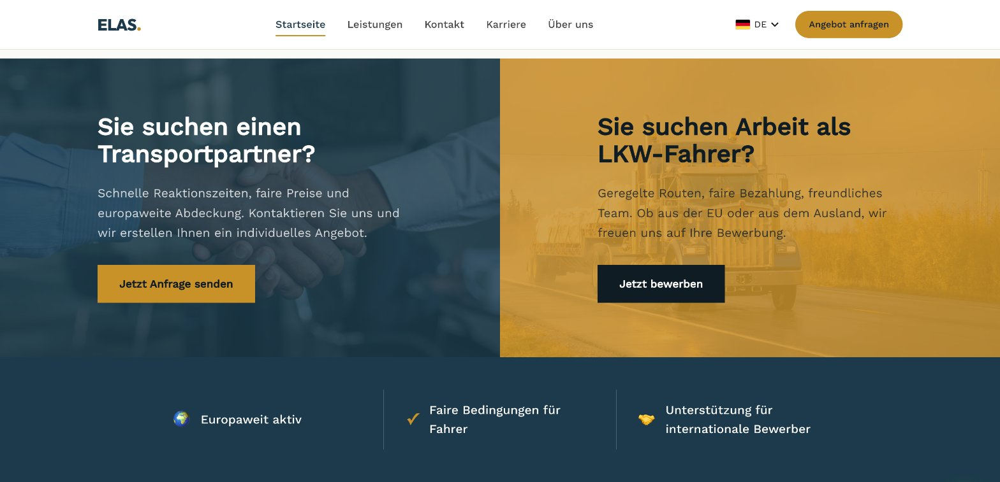

# Website für die Spedition ELAS

**Kundenprojekt (Freelance)** · [Live ansehen](https://spedition-elas.com) · [Zurück zur Übersicht](../README.md)

## Worum geht es?

Die Spedition ELAS GmbH aus Magdeburg wollte mit einer Website zwei ganz unterschiedliche Gruppen erreichen: Firmen, die einen Transport brauchen, und LKW-Fahrer, die einen Job suchen. Viele Fahrer kommen aus dem Ausland, deshalb musste die Seite in mehreren Sprachen funktionieren.

## Was ich umgesetzt habe

- **Zwei klare Wege:** "Anfrage senden" für Kunden und "Als Fahrer bewerben" für Bewerber, direkt auf der Startseite
- **Sieben Sprachen:** Deutsch, Englisch, Türkisch, Arabisch, Rumänisch, Albanisch und Russisch
- **Kontakt per WhatsApp** mit einem Klick
- **Eigene Domain** inklusive DNS-Einrichtung und Transaktions-E-Mails über Resend
- **Laufende Betreuung** des Kunden bei IT- und E-Mail-Themen

## Tech-Stack

Webentwicklung · Mehrsprachigkeit · DNS · Resend · WhatsApp-Integration
