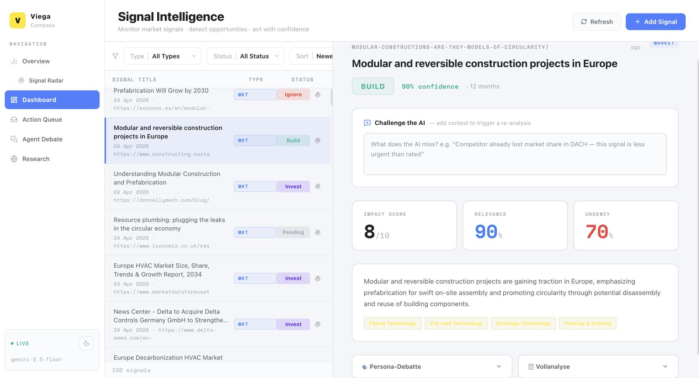
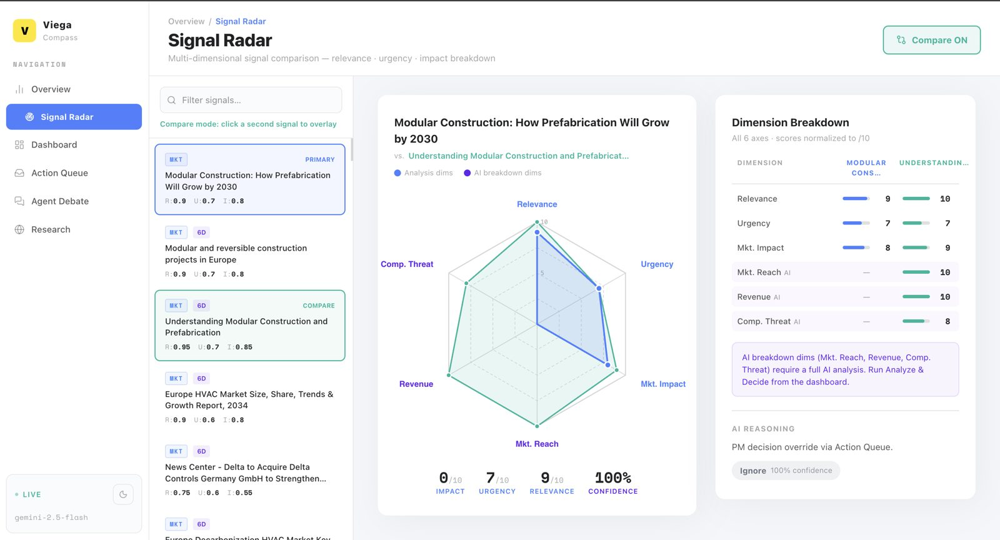
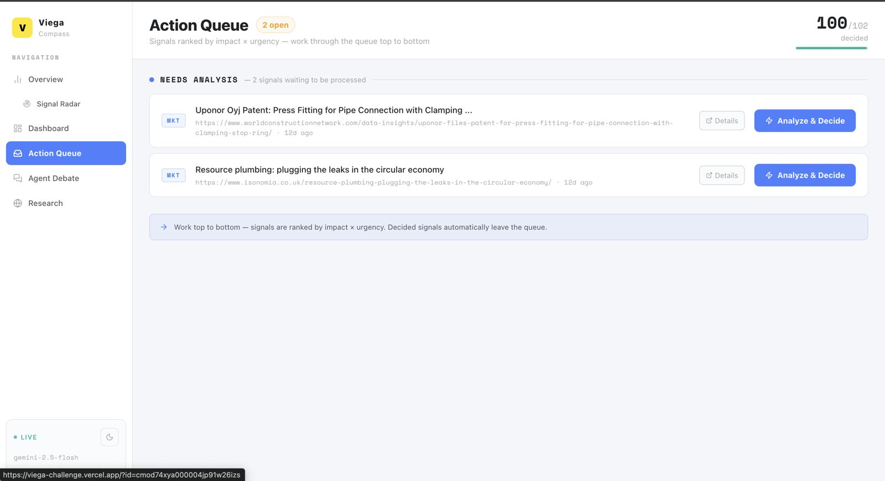
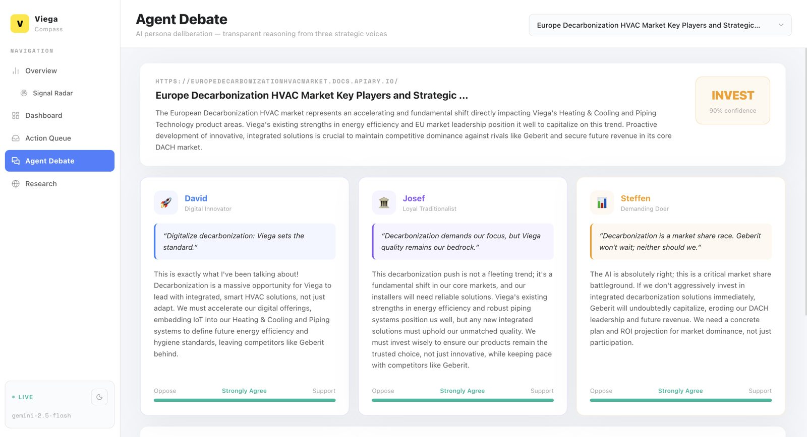
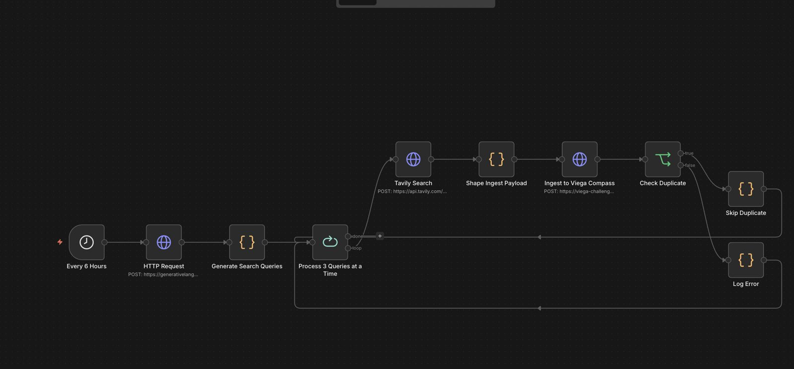

# Viega Compass

**3. Platz beim Futury Hackathon (Viega Challenge)** · [Live-Demo](https://viega-challenge.vercel.app) · [Code](https://github.com/Haytam-coder/viega-challenge) · [Zurück zur Übersicht](../README.md)

## Worum geht es?

Viega ist ein großer Hersteller von Installationstechnik. Bei der Challenge ging es darum, wie so ein Unternehmen früh erkennt, welche Markttrends, Patente und Wettbewerber wirklich relevant sind und was es daraus machen soll.

Meine Antwort ist Viega Compass. Die Plattform sammelt automatisch Marktsignale, bewertet sie mit KI und macht daraus eine sortierte Liste von Entscheidungen: **bauen, investieren oder ignorieren**.

## Wie es funktioniert

1. **Datensammlung mit n8n:** Ein Workflow läuft alle sechs Stunden, erzeugt Suchanfragen, sucht über Tavily nach neuen Signalen, bereitet die Treffer auf, prüft auf Duplikate und schickt sie an die App.
2. **Bewertung:** Jedes Signal bekommt Scores für Impact, Relevanz und Dringlichkeit sowie eine Konfidenz.
3. **Signal Radar:** Signale lassen sich in mehreren Dimensionen vergleichen, zum Beispiel Marktreichweite, Umsatzpotenzial und Wettbewerbsdruck.
4. **Agent Debate:** Drei KI-Personas mit unterschiedlichen Sichtweisen diskutieren ein Signal und geben eine Empfehlung ab.
5. **Action Queue:** Die wichtigsten offenen Signale stehen oben, sortiert nach Impact und Dringlichkeit.

## Screenshots

**Übersicht mit Pipeline-Status und Entscheidungsverteilung**

**Signal Intelligence: einzelnes Signal mit Scores und "Challenge the AI"**

**Signal Radar: Vergleich in mehreren Dimensionen**

**Action Queue**

**Agent Debate mit drei KI-Personas**

**n8n-Workflow für die automatische Datensammlung**

## Tech-Stack

Next.js · React · TypeScript · Tailwind CSS · Prisma · PostgreSQL · n8n · Tavily Search · Gemini 2.5 Flash · Vercel

## Meine Rolle

Ich habe das Projekt allein konzipiert, unter Zeitdruck umgesetzt und vor einer Jury aus Industrieexperten präsentiert.
